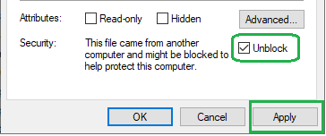

# PNG_Export_Tools
Two stand-alone PowerShell scripts that save every page of a document as a PNG, the way
**File > Save As > PNG** does, through the Office application's own COM interface:

| Script | Saves | Needs |
| --- | --- | --- |
| `PptxToPng.ps1` | every slide of a PowerPoint `.pptx` | PowerPoint |
| `PubToPng.ps1` | every page of a Publisher `.pub` | Publisher |

PowerPoint and Publisher draw the pages themselves, so fonts, line breaks and shapes come out
as each application shows them. At the same `-Dpi`, a publication's pages and its converted
slides are the same size, so the two can be compared pixel for pixel, for instance to check a
`.pptx` made by [PublisherToPPTX](https://github.com/Dave3Young/PublisherToPPTX) against the
original publication.

## Unblock the scripts after downloading
Windows marks files downloaded from the internet as blocked, and PowerShell may then refuse to
run them with an error such as "is not digitally signed" or "cannot be loaded". Before running
a script for the first time, unblock it:
1. In File Explorer, right-click the script and choose **Properties**.
2. On the **General** tab, tick **Unblock**, then click **Apply** and **OK**.



Or unblock every script in the folder at once from PowerShell:

```powershell
Get-ChildItem *.ps1 | Unblock-File
```

If you downloaded the repository as a ZIP, unblock the ZIP the same way before extracting it,
and every file inside comes out unblocked. If there is no **Unblock** checkbox, the file is not
blocked.

## Requirements
- Windows 10/11 with Windows PowerShell 5.1 or PowerShell 7.
- Microsoft PowerPoint installed for `PptxToPng.ps1`, Microsoft Publisher for `PubToPng.ps1`.

## PptxToPng.ps1
Saves every slide of a `.pptx` as a PNG, as **File > Save As > PNG** does in PowerPoint:
each `Deck.pptx` gets a `Deck\` folder holding `Slide1.PNG`, `Slide2.PNG` and so on. Files
already in that folder with the same names are replaced.

```powershell
.\PptxToPng.ps1 -Path .\MyFlyer\MyFlyer.pptx
.\PptxToPng.ps1 -Path C:\Pubs -Recurse -Dpi 150
```

| Parameter | Default | Meaning |
| --- | --- | --- |
| `-Path` | (required) | A `.pptx` file, or a folder of them. |
| `-Recurse` | | With a folder, also convert the `.pptx` files in its subfolders. |
| `-OutputFolder` | beside each `.pptx` | Where each presentation's PNG folder is made. |
| `-Dpi` | Save As's own size | Pixels per inch of slide. Save As follows PowerPoint's export resolution setting, 96 dpi unless changed. At 150 dpi a letter page is 1275 x 1650. |

## PubToPng.ps1
Saves every page of a `.pub` as a PNG, as **File > Save As > PNG** does in Publisher for the
page showing. Each `Flyer.pub` gets a `Flyer_pages\` folder holding `Page1.png`, `Page2.png`
and so on. Files already in that folder with the same names are replaced. The folder is not
`Flyer\`, which is where PublisherToPPTX's stage 1 writes its export.

```powershell
.\PubToPng.ps1 -Path .\MyFlyer.pub
.\PubToPng.ps1 -Path C:\Pubs -Recurse -Dpi 300
```

| Parameter | Default | Meaning |
| --- | --- | --- |
| `-Path` | (required) | A `.pub` file, or a folder of them. |
| `-Recurse` | | With a folder, also convert the `.pub` files in its subfolders. |
| `-OutputFolder` | beside each `.pub` | Where each publication's PNG folder is made. |
| `-Dpi` | 150 | Pixels per inch of page: 96, 150 or 300, Publisher's own picture resolutions. |

## License
GNU General Public License v3.0. See [LICENSE](LICENSE).
